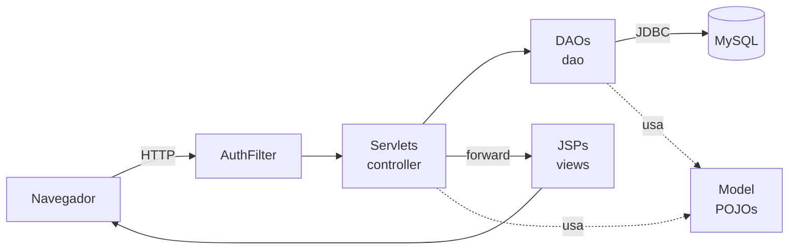
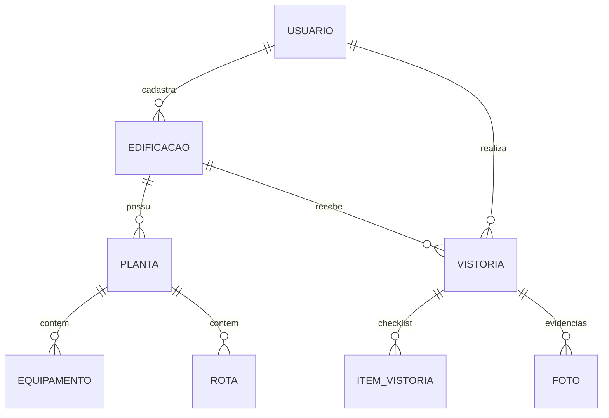

# VistorIA — Vistorias de Segurança Contra Incêndio

> Projeto desenvolvido por estudantes do **Entra21 — trilha Desenvolvimento Java**.

O **VistorIA** é um sistema web para profissionais que fazem vistorias de segurança contra incêndio em edificações (engenheiros, técnicos de segurança, brigadistas). Ele substitui a prancheta e a planilha: o vistoriador cadastra o prédio, marca os equipamentos de combate a incêndio direto na planta baixa, preenche um checklist padronizado e gera um relatório pronto para imprimir ou exportar em PDF.

> **Sobre o nome:** o "IA" de VistorIA aponta para a evolução planejada do projeto, que é usar Inteligência Artificial para processar os dados das vistorias. A versão atual não usa IA, e todo o código foi escrito pelos estudantes, sem ferramentas de IA para programar.

---

## O problema que resolvemos

Uma vistoria de prevenção a incêndio costuma gerar papel solto: anotações à mão, fotos no celular, planilhas separadas e plantas impressas rabiscadas. Isso dificulta:

- saber **onde** está cada extintor, hidrante ou saída de emergência;
- acompanhar **o que está irregular** e com qual urgência;
- comparar vistorias ao longo do tempo;
- entregar ao cliente um relatório organizado.

O VistorIA centraliza tudo isso em um único lugar, por edificação.

## Funcionalidades

| Módulo | O que faz |
|---|---|
| **Cadastro e login** | Cada vistoriador tem sua conta. Senhas são armazenadas como hash, e um filtro de autenticação protege todas as páginas internas. |
| **Dashboard** | Visão geral: total de edificações, vistorias realizadas, vistorias pendentes e não conformidades em aberto. |
| **Edificações** | Cadastro completo do imóvel: razão social, CNPJ, endereço, área construída, número de pavimentos, altura, ocupantes, subsolo, mezanino etc. |
| **Plantas interativas** | Upload da planta baixa de cada pavimento. Sobre a imagem, o usuário clica para posicionar **extintores, hidrantes, saídas de emergência, iluminação de emergência e alarmes**, e desenha as **rotas de fuga**. |
| **Vistorias com checklist** | Checklist padronizado com 6 categorias (Extintores, Saídas de emergência, Rotas de fuga, Hidrantes, Iluminação de emergência, Alarmes). Cada item é marcado como conforme ou não conforme, com gravidade (baixa, média, alta) e observação. |
| **Fotos** | Anexo de fotos às vistorias como evidência, com descrição e localização. |
| **Não conformidades** | Lista consolidada de todos os problemas encontrados, com possibilidade de atualizar status e gravidade conforme forem corrigidos. |
| **Histórico** | Consulta das vistorias anteriores com filtros por edificação e status. |
| **Relatório** | Relatório formatado da vistoria, com dados da edificação, checklist e fotos, pronto para **imprimir ou salvar em PDF**. |

## Tecnologias

- **Java 17**
- **Jakarta Servlet 6.0** e **JSP + JSTL 3.0** (camada web)
- **MySQL 8** com **JDBC** puro (sem ORM)
- **Maven** (build e dependências, empacotado como `.war`)
- **Apache Tomcat 10.1+** (testado no Tomcat 11)
- **HTML, CSS e JavaScript** puros no front-end, com **SVG** para desenhar as rotas na planta

Escolhemos trabalhar sem frameworks como Spring ou Hibernate de propósito: o objetivo do curso era entender **como a web em Java funciona por baixo**, ou seja, ciclo de requisição/resposta, sessões, filtros, upload de arquivos e acesso a banco com SQL escrito à mão.

## Arquitetura

O projeto segue o padrão **MVC** com a camada **DAO** para acesso a dados:



```
src/main/java/br/com/vistoria/
├── controller/   Servlets: recebem a requisição, validam e decidem a próxima tela
├── dao/          Data Access Objects: todo o SQL do sistema (PreparedStatement)
├── model/        Classes de domínio: Usuario, Edificacao, Planta, Equipamento, Rota, Vistoria...
├── filter/       AuthFilter: bloqueia acesso sem login
└── util/         Conexão com o banco, hash de senha e upload de arquivos

src/main/webapp/
├── WEB-INF/views/   Telas JSP (protegidas, só acessíveis via servlet)
├── css/             Estilos
└── uploads/         Plantas e fotos enviadas
```

### Boas práticas aplicadas

- **Separação de responsabilidades:** servlets não contêm SQL, e JSPs não contêm regra de negócio.
- **Prevenção de SQL Injection:** todas as consultas usam `PreparedStatement`.
- **Isolamento de dados por usuário:** antes de editar ou excluir qualquer registro, os DAOs verificam (`pertence(id, usuarioId)`) se ele pertence ao usuário logado. Um usuário não consegue acessar dados de outro alterando o ID na URL.
- **Views protegidas:** as JSPs ficam dentro de `WEB-INF`, então não podem ser abertas diretamente pelo navegador.
- **Senhas com hash:** nenhuma senha é salva em texto puro.

## Modelo de dados



O script completo (tabelas + dados de demonstração) está em [`sql/schema.sql`](sql/schema.sql).

## Como executar

### Pré-requisitos

- JDK 17 ou superior
- Maven 3.8+
- MySQL 8
- Apache Tomcat **10.1 ou superior** (o Tomcat 9 não é compatível, pois o projeto usa `jakarta.*`)

### Passo a passo

1. **Clone o repositório**
   ```bash
   git clone https://github.com/VilmarJ/vistorIA.git
   cd vistorIA
   ```

2. **Crie o banco de dados** executando o script no MySQL:
   ```bash
   mysql -u root -p < sql/schema.sql
   ```

3. **Configure a conexão** (se necessário) em [`Conexao.java`](src/main/java/br/com/vistoria/util/Conexao.java). O padrão é:
   ```
   URL:     jdbc:mysql://localhost:3306/vistoria_ia
   Usuário: root
   Senha:   root
   ```

4. **Gere o pacote**
   ```bash
   mvn clean package
   ```

5. **Publique no Tomcat** copiando `target/vistoria-ia.war` para a pasta `webapps/` do Tomcat e inicie o servidor.

6. **Acesse** <http://localhost:8080/vistoria-ia>

### Usuário de demonstração

O script SQL já cria uma conta com uma edificação, uma planta com equipamentos posicionados e uma vistoria concluída, para você explorar o sistema sem precisar cadastrar nada:

| E-mail | Senha |
|---|---|
| `demo@vistoria-ia.com` | `123456` |

## O que aprendemos

Este projeto foi a aplicação prática do conteúdo do curso. Nele exercitamos:

- Orientação a objetos em Java (encapsulamento, classes de domínio, constantes de status)
- Desenvolvimento web com Servlets, JSP, JSTL e Expression Language
- Gerenciamento de sessão e autenticação com filtros
- Modelagem de banco relacional, chaves estrangeiras e SQL com JOINs
- JDBC e o padrão DAO
- Upload de arquivos com `@MultipartConfig`
- Build e empacotamento com Maven
- Deploy em servidor de aplicação (Tomcat)
- Interface interativa com JavaScript e SVG
- Trabalho em equipe e versionamento com Git/GitHub

## Próximos passos

Melhorias que identificamos para uma versão futura:

- [ ] **Integrar Inteligência Artificial** para processar os dados das vistorias (a proposta que dá nome ao projeto)
- [ ] Trocar o hash SHA-256 por **BCrypt** (com salt e custo configurável)
- [ ] Ler as credenciais do banco de **variáveis de ambiente** em vez de deixá-las no código
- [ ] Usar um **pool de conexões** (ex.: HikariCP)
- [ ] Adicionar **testes automatizados** (JUnit) para DAOs e regras de negócio
- [ ] Gerar o relatório em PDF no servidor
- [ ] Otimizar a interface para uso em tablet durante a vistoria em campo
- [ ] Containerizar com **Docker** (app + MySQL) para facilitar a execução

## Autor

**Vilmar Junior** · [@VilmarJ](https://github.com/VilmarJ)

Estudante do **Entra21 — Desenvolvimento Java**.

---

<p align="center">Feito com ☕ e Java durante o <strong>Entra21</strong>.</p>
